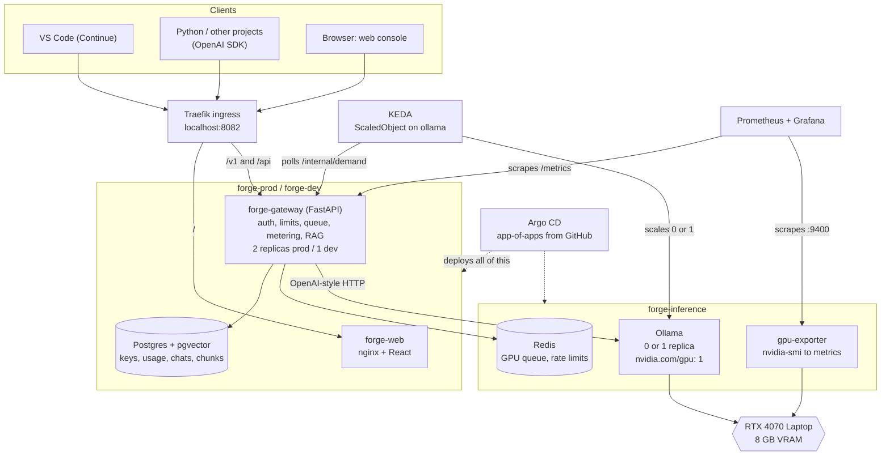
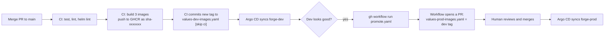

# Forge

A private, OpenAI-compatible LLM API and coding assistant that runs on **one RTX 4070 Laptop GPU (8 GB)** inside a local Kubernetes cluster. No paid API, no code leaving the laptop.

Point any OpenAI SDK, VS Code (Continue) or your other projects at `http://forge.localhost:8082/v1` and it just works.

---

## Features

| Feature | What you get |
|---|---|
| OpenAI-compatible API | `/v1/models`, `/v1/chat/completions` (streaming), `/v1/completions` (with `suffix` for fill-in-the-middle), `/v1/embeddings` |
| Three models on one GPU | `forge-chat` (Qwen2.5-Coder 7B), `forge-autocomplete` (Qwen2.5-Coder 1.5B base), `forge-embed` (nomic-embed-text), all resident at once |
| API keys | Hashed at rest, shown once, per-key requests/minute limit and daily token quota, revocable |
| Shared GPU queue | Redis priority queue across all gateway replicas: autocomplete first, then chat, then batch; a slot is reserved for autocomplete while you type |
| Scale to zero | After 10 idle minutes Ollama is scaled to 0 and the VRAM is freed; the next request wakes it (about 15 s) |
| Web console | Chat with history, "Ask my repo" (RAG with citations), API keys, usage, system/GPU status, connect snippets |
| Chat attachments | Attach files or a whole folder (button or drag and drop). Binaries, `node_modules`/`.git`/build folders and files over 100 KB are skipped; up to 24k characters go into the message |
| Editor (vibe-code workspace) | `/workspace`: project folders on the server (empty, or cloned from GitHub/GitLab/Codeberg), file tree, CodeMirror editor, AI-proposed edits shown as a diff before you apply them, ZIP download, git status/diff/commit/push |
| RAG | Index a public Git repo into Postgres + pgvector, ask questions, get answers with `[n]` source citations |
| Metering | Every request is recorded (tokens, queue time, time to first token, tokens/s) and exported to Prometheus |
| Observability | Prometheus + Grafana dashboard "Forge" (GPU, queue, latency, tokens) |
| GitOps | Argo CD app-of-apps deploys everything from this repo; models are changed with a pull request |
| CI/CD | GitHub Actions: lint, tests, Helm lint, image build to GHCR, auto-deploy to dev, promote to prod by PR |
| Two environments | `forge-dev` and `forge-prod` share one GPU tier |

---

## Architecture



New to GPU serving? Read [docs/LEARNING-GUIDE.md](docs/LEARNING-GUIDE.md) first.

---

## URLs

All names go through the k3d load balancer on port **8082**.

| What | URL |
|---|---|
| Prod web console | http://forge.localhost:8082 |
| Prod API base (OpenAI-compatible) | http://forge.localhost:8082/v1 |
| Dev web console and API | http://forge-dev.localhost:8082 (API: `/v1`) |
| Grafana | http://grafana.localhost:8082 |
| Argo CD | http://argocd.localhost:8082 (user `admin`) |

`/internal/*` and `/metrics` of the gateway are deliberately not routed by the ingress.

---

## Quick start

Prerequisites: Windows 11, Docker Desktop (WSL2 backend), NVIDIA driver, `k3d`, `kubectl`, `helm`, `git` on PATH.

```powershell
# 1. Everything from zero (idempotent, safe to re-run). First run: about 20-40 min (image pulls, ~6 GB of models).
powershell -ExecutionPolicy Bypass -File scripts\up.ps1

# 2. Windows only resolves *.localhost inside browsers. For Python, curl and VS Code add hosts entries
#    (up.ps1 offers this; or run from an ADMINISTRATOR PowerShell):
powershell -ExecutionPolicy Bypass -File scripts\add-hosts.ps1
```

3. Open http://forge.localhost:8082 and log in. The admin password is in `secrets\prod-admin-password.txt` (dev: `secrets\dev-admin-password.txt`).
4. Go to **API keys**, create a key (name it e.g. `my-script`). Copy the `fk_...` key now. It is shown only once.
5. Test it:

```powershell
$env:FORGE_API_KEY = "fk_..."
curl.exe http://forge.localhost:8082/v1/models -H "Authorization: Bearer $env:FORGE_API_KEY"
```

The first request after a long idle wakes the GPU backend and takes about 15 seconds. See [docs/COMMANDS.md](docs/COMMANDS.md) for every command.

Tear down: `powershell -ExecutionPolicy Bypass -File scripts\down.ps1` (keeps `secrets\`).

---

## Use it from Python

```powershell
pip install -r integrations\python\requirements.txt
$env:FORGE_API_KEY = "fk_..."
python integrations\python\example.py          # models, chat, stream, fim, embed
python integrations\python\example.py stream   # just one demo
```

```python
from openai import OpenAI
client = OpenAI(base_url="http://forge.localhost:8082/v1", api_key="fk_...")
reply = client.chat.completions.create(
    model="forge-chat",
    messages=[{"role": "user", "content": "Explain Python generators in two sentences."}],
)
print(reply.choices[0].message.content)
```

See [integrations/python/example.py](integrations/python/example.py).

## Use it in VS Code

Forge gives you chat, inline edit, tab autocomplete and `@codebase` embeddings through the Continue extension. Install steps and the reasoning behind the config are in [integrations/vscode/README.md](integrations/vscode/README.md). Short version: create an API key named `vscode`, copy `integrations\vscode\config.yaml` to `%USERPROFILE%\.continue\config.yaml`, put `FORGE_API_KEY=fk_...` into `%USERPROFILE%\.continue\.env`, reload VS Code.

---

## How promotion dev -> prod works



- Dev follows every merge automatically. Prod only changes when a human merges a promotion PR.
- `forge-inference` (Ollama, Redis, gpu-exporter) is one shared release. Its exporter image moves with dev and is not promoted.
- Models change the same way: edit `gitops/models.yaml` in a PR. See [docs/COMMANDS.md](docs/COMMANDS.md).

---

## Repository layout

| Path | What is in it |
|---|---|
| `gateway/` | FastAPI gateway: auth, scheduler, backend wake-up, metering, `/v1` routes, admin API, RAG, Alembic migration, tests |
| `web/` | React + TypeScript + Vite console, served by nginx-unprivileged |
| `gpu-exporter/` | Tiny Python service turning `nvidia-smi` into Prometheus metrics and JSON |
| `charts/forge/` | Helm chart for one environment (gateway, web, Postgres, ingress); values for dev and prod |
| `charts/forge-inference/` | Helm chart for the shared GPU tier (Ollama, KEDA ScaledObject, Redis, exporter, dashboard) |
| `gitops/` | Argo CD: `bootstrap/` (Argo install + root app), `apps/` (child apps), `envs/` (namespaces, sealed secrets), `models.yaml` |
| `cluster/` | GPU-capable k3s node image, k3d config, NVIDIA device plugin |
| `scripts/` | `up.ps1`, `down.ps1`, `add-hosts.ps1`, `seal-secrets.ps1` |
| `integrations/` | Python example and VS Code (Continue) config |
| `bench/` | `bench.py` (per-model speed and VRAM), `loadtest.py` (priority queue behaviour) |
| `results/` | Measured results: [BENCHMARK.md](results/BENCHMARK.md) |
| `docs/` | Spec and guides (below) |
| `.github/` | CI, promote workflow, image-values script |
| `secrets/` | Plain-text secrets, git-ignored. Never commit |

## Documentation

| Doc | For |
|---|---|
| [docs/LEARNING-GUIDE.md](docs/LEARNING-GUIDE.md) | Beginner explanation of how it all works, file by file, plus the problems we hit |
| [docs/COMMANDS.md](docs/COMMANDS.md) | Every command and a troubleshooting table |
| [docs/TECH-STACK.md](docs/TECH-STACK.md) | Every component, pinned version, and why |
| [docs/SPEC.md](docs/SPEC.md) | The architecture contract the build followed |
| [results/BENCHMARK.md](results/BENCHMARK.md) | Measured numbers |
| [gateway/README.md](gateway/README.md), [web/README.md](web/README.md) | Component details |

---

## Measured results

RTX 4070 Laptop 8 GB, everything on this machine, 2026-10-25. Details in [results/BENCHMARK.md](results/BENCHMARK.md).

| Measurement | Result |
|---|---|
| VRAM with all 3 models resident | about 7.6-8.1 GB, 100% on GPU |
| Chat (`forge-chat`, alone) | 49 tok/s, time to first token p50 about 52 ms |
| Autocomplete (alone) | p50 270-365 ms, p95 505-754 ms |
| Embeddings (warm) | 0.30-0.37 s |
| Autocomplete p95 under chat flood | 4297 ms before reserved slot, 2146 ms after (queue wait p95 4070 ms to 1 ms) |
| Rate limit across 2 replicas | exact: burst of 10 with rpm=3 gave 3x 200 and 7x 429 |
| Scale to zero | VRAM 7648 to 811 MiB (6.8 GB freed); wake to first token 15.3 s |
| RAG index (`pallets/click`) | 166 files, 871 chunks in 13.2 s |
| QA | 137/145 checks first round; retest 40/41 |

## Known limits

- One GPU, so real parallelism is limited. When the 7B generates, the 1.5B autocomplete model drops from about 125 to 27 tok/s (compute sharing). Autocomplete under a chat flood still has a p95 of about 2 s.
- A 7B model is not GPT-class. Multi-step tool use (Continue agent mode) is off.
- Retrieval quality is bounded by the small embedding model (one retest question missed).
- First request after idle takes about 15 s (model reload). First install downloads about 6 GB.
- Local-only: plain HTTP on `localhost`, no TLS, one admin password, no user accounts (API keys only).
- RAG accepts only public `https://` repos on github.com, gitlab.com, codeberg.org; max 3000 files / 30 MB per repo.
- Editor: workspaces live on one ReadWriteOnce volume, shared by both prod gateways only because k3d has a single node. Clones are shallow (latest commit). Pushing needs a token (GitHub fine-grained: Contents read and write); it is used for that one push and never stored. AI edits rewrite the whole file, so files over about 12k characters may be cut off by the 8k-token model.
- Windows + Docker Desktop + WSL2 + NVIDIA only. Not tested elsewhere.
- Argo CD deploys what is on GitHub, not what is on disk: push before expecting a change in the cluster.
