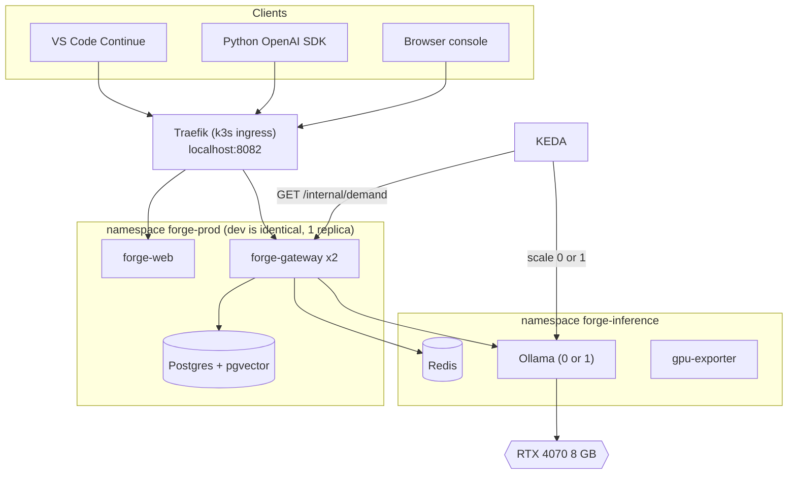
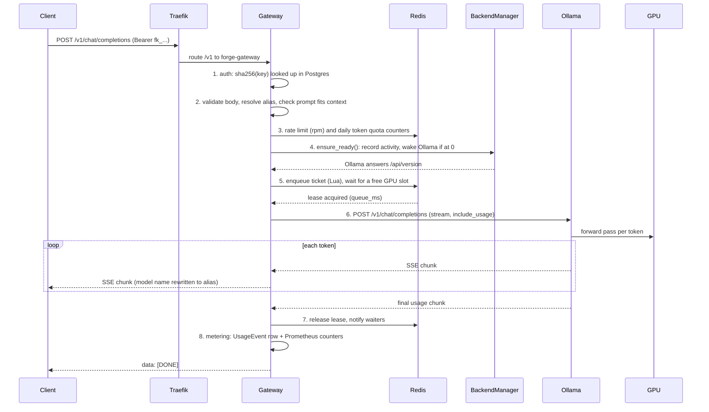
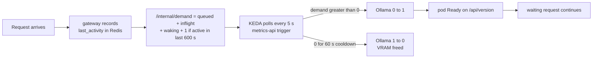
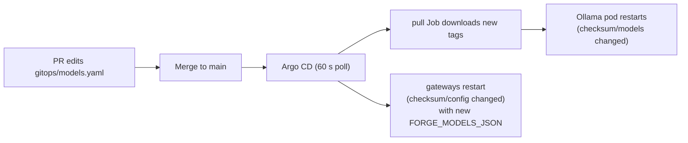

# Forge: Learning Guide

This guide explains **how a request travels from your Python script or VS Code to the GPU and back**, why Forge is built the way it is, and what the important files do. You already know Docker, CI/CD, Kubernetes, Helm, Argo CD and observability. The new part is **serving LLMs on a GPU for several users at once**. Read it top to bottom once; later use it as a reference.

If the GPU layers (WSL2, `/dev/dxg`, NVIDIA runtime, device plugin) are unclear, read `gpu-hello\docs\LEARNING-GUIDE.md` first. Forge reuses that work.

---

## 1. The big idea in 6 sentences

1. gpu-hello proved one pod can use the GPU. **Forge turns that into a product**: an OpenAI-compatible API that many programs (and you in VS Code) can share.
2. One 8 GB GPU is a scarce resource. If three requests arrive at once, someone must wait. A **queue with priorities** decides who goes first, so typing in VS Code never feels slow.
3. The GPU is also expensive to keep loaded (it holds ~7 GB of VRAM that Windows needs for other things). **Scale to zero** frees it when nobody asks for 10 minutes.
4. Anyone with the URL could burn the GPU, so the **gateway** adds API keys, rate limits, daily token quotas and usage records.
5. Everything is deployed by **GitOps**: change a file in Git, Argo CD changes the cluster. Even the list of models is a file (`gitops/models.yaml`).
6. Because the API looks exactly like OpenAI's, any tool that supports OpenAI works with Forge by changing one URL.

---

## 2. The big picture



Two environments (`forge-dev`, `forge-prod`) each have their own gateway, web and Postgres, but they **share one Ollama, one Redis and one GPU**. That is why the queue lives in Redis and not in the gateway's memory: the dev and prod gateways must queue for the same GPU.

---

## 3. The journey of one request

What happens when you run `client.chat.completions.create(model="forge-chat", ...)`:



The order matters. Cheap checks (auth, limits) come before anything that costs GPU time. The wake-up comes before queueing, because waiting for a slot while the GPU is off is pointless. The slot is held only while Ollama is generating.

The headers on every answer tell you what happened: `x-request-id`, `x-forge-queue-ms` (time spent waiting), `x-forge-model` (the real Ollama model).

---

## 4. Concepts you need

### 4.1 OpenAI-compatible API

OpenAI's HTTP format became the de facto standard. Ollama already speaks it, so why a gateway in between? Because Ollama has **no users**: no keys, no limits, no usage, no queue. The gateway adds those and keeps the same JSON shapes (including error bodies like `{"error": {"type": ..., "code": ...}}`), so unchanged client code works.

| Endpoint | Use |
|---|---|
| `GET /v1/models` | List aliases (`forge-chat`, `forge-autocomplete`, `forge-embed`) |
| `POST /v1/chat/completions` | Chat, streaming or not |
| `POST /v1/completions` | Raw text completion; `suffix` gives fill-in-the-middle |
| `POST /v1/embeddings` | Text to vectors |

**Aliases** (`forge-chat`) decouple clients from model names. Swap the 7B for a bigger model in `models.yaml` and no client changes.

### 4.2 SSE streaming

With `stream: true` the server keeps the connection open and sends lines like:

```text
data: {"choices":[{"delta":{"content":"Hel"}}]}

data: {"choices":[{"delta":{"content":"lo"}}]}

data: [DONE]
```

That is Server-Sent Events: plain HTTP, one `data:` line per event. It is why answers appear word by word. The gateway passes chunks through unchanged, but asks Ollama for a final **usage chunk** (`stream_options.include_usage`) so it can count tokens exactly. It forwards that chunk to the client only if the client asked for it, like OpenAI does.

### 4.3 FIM autocomplete

Chat models answer questions. **Autocomplete** must fill a gap in code: text before the cursor (prefix) and after it (suffix). Code models are trained on a special format:

```text
<|fim_prefix|>def add(a, b):\n    return <|fim_suffix|>\n\nprint(add(1, 2))<|fim_middle|>
```

and they generate what belongs in the middle (`a + b`). This is **fill-in-the-middle (FIM)**. Forge supports it two ways: send `prompt` and `suffix` to `/v1/completions` and Ollama builds the template, or the client builds the raw prompt itself (what Continue does).

**The autocomplete model must be a base model.** An instruct model wraps the raw prompt in a chat template and answers like a chat ("Certainly! Here is..."). We measured the 7B instruct as FIM model: 9 of 15 completions were chat prose, and it was 5x slower (p50 1583 ms). The 1.5B **base** model is both better and faster.

### 4.4 Embeddings, RAG, pgvector, HNSW, cosine

- An **embedding** turns text into a list of numbers (768 for `nomic-embed-text`) so that texts with similar *meaning* have similar vectors.
- **RAG** (retrieval-augmented generation): the 7B model does not know your repo. So we (1) cut the repo into chunks, (2) embed each chunk, (3) at question time embed the question, find the nearest chunks, (4) paste them into the prompt and tell the model "answer only from these sources, cite as [n]".
- **pgvector** is a Postgres extension that stores vectors and searches them. No separate vector database needed.
- **Cosine distance** measures the angle between two vectors, ignoring length. Smaller means more similar. pgvector's operator is `<=>`; Forge reports `score = 1 - distance`.
- **HNSW** is an index that finds near neighbours without comparing against every row (a layered "small world" graph). It trades a tiny bit of accuracy for big speed. Forge sets `hnsw.ef_search = 100` and `hnsw.iterative_scan = strict_order` so that filtering by `repo_id` still returns enough rows.
- `nomic-embed-text` is trained with **task prefixes**: documents get `search_document: `, questions get `search_query: `. `models.yaml` stores them and the RAG code adds them. Forgetting this noticeably hurts retrieval.

### 4.5 The GPU priority queue (Redis, Lua, leases)

Rules:

| Priority | Who | Why first/last |
|---|---|---|
| 0 AUTOCOMPLETE | tab completion | a human is waiting on every keystroke |
| 1 CHAT | chat, RAG answers | a human is reading |
| 2 BATCH | embeddings, indexing | nobody is waiting |

How it works (all in `gateway/app/scheduler.py`):

- A request puts a **ticket** into a Redis sorted set. Score = `priority * 10**13 + enqueue_ms`. Lower score goes first, so priority wins and each priority is FIFO.
- It may start when it is among the first *N* tickets, where *N* = free slots (`FORGE_MAX_INFLIGHT`, default 2, minus live leases).
- Check-and-take must be **atomic**, or two replicas could both grab the last slot. A **Lua script** runs inside Redis as one indivisible step.
- A **lease** is a Redis key with a short TTL. The holder refreshes it every 5 s. If a gateway pod crashes mid-request, the lease expires and the slot frees itself. No manual cleanup.
- Waiters learn that a slot freed through Redis **pub/sub**, with a 0.5 s poll as fallback.
- **Supersession**: a newer autocomplete request from the same key cancels that key's older queued autocomplete (the old text is obsolete anyway).
- **Reserved slot**: with 2 slots, two long chats could occupy both and an autocomplete would wait seconds. So while an autocomplete arrived in the last 30 s ("someone is typing"), chat and batch may use only `MAX_INFLIGHT - 1` slots. When nobody types, chat uses both. See section 7e for the measured effect.
- Full queue returns 429 `queue_full`; waiting past 120 s returns 504 `queue_timeout`.

### 4.6 Scale to zero with KEDA

Ollama with 3 models holds ~7.6 GB of VRAM even when idle (`OLLAMA_KEEP_ALIVE=30m`). Scale-to-zero frees it for games, video calls or other work.



- The gateway exposes the **demand number** at `/internal/demand` (not reachable from outside; the ingress does not route it).
- KEDA's `metrics-api` trigger reads that JSON field and scales the Deployment between 0 and 1. KEDA polls both namespaces; since both gateways share Redis, either one reports the whole GPU.
- Total idle time before the GPU is released: 600 s (`FORGE_IDLE_SECONDS`) + 60 s (`cooldownPeriod`).
- A request that arrives while Ollama is at 0 does not fail: `BackendManager.ensure_ready()` raises the demand and waits up to 240 s for readiness.
- If a gateway is unreachable, KEDA's `fallback` keeps 1 replica after 3 failed polls (the safe side).

### 4.7 VRAM budget and KV cache

VRAM must hold: model weights + **KV cache** (memory of the conversation so far; grows with context length) + overhead. We have about 6.8 GB free after Windows takes its share.

| Item | Size measured |
|---|---|
| qwen2.5-coder:7b (Q4) | 5.02 GB resident |
| qwen2.5-coder:1.5b-base | 1.30 GB |
| nomic-embed-text:v1.5 | 0.32 GB |
| Total used with all three | about 7.6-8.1 GB |

It fits only with tuning, set as Ollama env vars in `charts/forge-inference/values.yaml`:

| Setting | Effect |
|---|---|
| `OLLAMA_FLASH_ATTENTION=1` | Less memory per token of context |
| `OLLAMA_KV_CACHE_TYPE=q8_0` | KV cache stored in 8 bits: half the size, negligible quality loss |
| `OLLAMA_NUM_PARALLEL=2` | Two requests at once; matches `FORGE_MAX_INFLIGHT=2` |
| `OLLAMA_MAX_LOADED_MODELS=3` | All three models may stay resident |
| `OLLAMA_KEEP_ALIVE=30m` | No reload between requests |
| `OLLAMA_CONTEXT_LENGTH=8192` | Bounds KV cache size |

**Context overflow trap:** if a prompt is longer than the context window, Ollama silently cuts it. The gateway estimates the prompt tokens first and returns 400 `context_length_exceeded` instead.

### 4.8 API key hashing

Keys look like `fk_` + 40 random URL-safe characters. The database stores only the **SHA-256 hash** plus a 10-character prefix for display. The plain key is returned once at creation. If the database leaks, the keys do not. SHA-256 (not bcrypt) is fine here because the keys are long random strings, not human passwords: brute force is infeasible and lookups stay fast on every request.

### 4.9 Admin session and CSRF

The web console logs in with the admin password and gets an HttpOnly, SameSite=Lax cookie (signed, 12 h; logout revokes the session id in Redis). Browsers send cookies automatically, so a malicious site could trick your browser into posting to Forge (**CSRF**). Defence: every state-changing cookie request must carry the header `X-Forge-Csrf: 1`. A cross-site form cannot add custom headers. API-key requests need no CSRF header, since they are not cookie-based. Login is limited to 5 failed attempts per minute per IP.

### 4.10 Sealed Secrets

Git must never contain passwords, but GitOps wants everything in Git. **Sealed Secrets** solves it: `kubeseal` encrypts a Secret with the cluster controller's public key. The encrypted `SealedSecret` is safe to commit; only the controller in that cluster can decrypt it into a normal Secret. Plain text lives in `secrets\*.txt` (git-ignored). Consequence: if you delete the cluster, its key is gone, and `up.ps1` re-seals the same plain-text secrets for the new key. You then push the new sealed files.

### 4.11 Argo CD: app-of-apps, sync waves, multi-source

- **App of apps:** `gitops/bootstrap/root-app.yaml` is one Application that points at the folder `gitops/apps/`. Each file there is another Application (keda, sealed-secrets, monitoring, forge-inference, forge-dev, forge-prod). Install Argo CD and the root app once; the rest follows from Git.
- **Sync waves** order the rollout with annotations (lower first):

| Wave | What |
|---|---|
| -10 | Namespaces (with Pod Security labels) |
| -5 | SealedSecrets (so Secrets exist before anything needs them) |
| -3 | sealed-secrets controller, KEDA (CRDs) |
| -2 | monitoring |
| -1 | Postgres, Redis, pull script ConfigMap |
| 0 | forge-dev, forge-prod, forge-inference apps; model pull Job; Ollama Deployment |
| 1 | migration Job, ScaledObject |
| 2 | gateway |

  Note the waves exist at two levels: between child Applications (needs the custom health check in `argocd-values.yaml`, otherwise a child app is "Healthy" the moment it exists) and between resources inside one app.
- **Multi-source:** `forge-inference`, `forge-dev` and `forge-prod` each read three sources: the chart, the env folder (sealed secrets, namespace) and `$values/gitops/models.yaml` as a Helm value file. One models file feeds all releases.

### 4.12 NetworkPolicies

Default-deny, then allow:
- Only gateway pods from `forge-dev` / `forge-prod` can reach `ollama:11434` and `redis:6379`.
- Only Prometheus can scrape the gpu-exporter.
- In `monitoring`: Prometheus is reachable only from Grafana; Grafana only from Traefik.
- Pod Security "restricted": non-root, read-only root filesystem where possible, all capabilities dropped, seccomp `RuntimeDefault`.

### 4.13 Prometheus and Grafana

The gateway exposes `/metrics`. The important ones:

| Metric | Meaning |
|---|---|
| `forge_requests_total{endpoint,model,status}` | Request counts |
| `forge_tokens_total{model,kind}` | Tokens processed |
| `forge_request_duration_seconds` | Latency histogram |
| `forge_ttft_seconds` | Time to first token |
| `forge_queue_wait_seconds{priority}` | Time waiting for a GPU slot |
| `forge_queue_depth{priority}`, `forge_inflight` | Queue state |
| `forge_demand`, `forge_backend_up` | Scale-to-zero signals |
| `forge_gpu_*` (from gpu-exporter) | Utilisation, VRAM, temperature, power |

The Grafana dashboard "Forge" is a ConfigMap labelled `grafana_dashboard: "1"`; Grafana's sidecar loads it. **Label cardinality warning:** never use client input as a label value. We hit this (section 7d).

---

## 5. File-by-file: the important lines

### `gateway/app/scheduler.py`: the heart

The acquire script (runs atomically inside Redis):

```lua
local free = tonumber(ARGV[3]) - live_leases(leases)
-- While someone is typing, keep slots free for autocomplete
local is_autocomplete = math.floor(tonumber(score) / tonumber(ARGV[6])) == 0
if not is_autocomplete and redis.call('EXISTS', KEYS[3]) == 1 then
  free = free - tonumber(ARGV[5])
end
if free <= 0 then return 0 end
```

`free` is slots minus live leases. If a chat or batch request is asking and the `autocomplete_active` key exists (set with a 30 s TTL by every autocomplete request), one slot is subtracted: the **reserved slot**. Then the script walks the queue in score order and only lets the ticket start if it is within the first `free` positions.

```python
score = int(priority) * PRIORITY_SPAN + int(time.time() * 1000)
```

One number encodes both priority and arrival order. `PRIORITY_SPAN = 10**13` is bigger than any millisecond timestamp.

```python
async with scheduler.slot(priority, principal_id, kind) as s: ...
```

A context manager: the lease is released in `finally` even on errors or cancellation, via `run_shielded` so a cancelled task still cleans up.

### `gateway/app/llm.py`: the one pipeline

`LLM.call()` is the single path every model call takes (the `/v1` routes **and** RAG):

```python
await self.metering.check_limits(principal)   # rpm + daily quota
await self.backend.ensure_ready()             # wake Ollama if needed
async with self.scheduler.slot(...) as slot:  # wait for the GPU
    yield record                              # caller talks to Ollama
...
finally:
    await run_shielded(self._finish(principal, record), what="recording usage")
```

Why it matters: exactly **one usage event per call**, success or failure, and RAG questions are queued and metered like any other request. `record_rejection()` logs refused requests with model `unknown` when the model string does not resolve (see 7d).

### `gateway/app/backend.py`: wake-up and demand

`ensure_ready()` writes `forge:gpu:last_activity` first (this is what makes KEDA see demand), then polls Ollama's `/api/version` until ready or 240 s. `demand()` returns `queued + inflight + waking + (1 if idle < 600 s)`. The `+1` keeps Ollama alive for 10 minutes after the last request even when the queue is empty.

### `gateway/app/routes/openai.py`: validation first, then proxy

Validation happens **before** queueing: strict body types, model role must match the endpoint (you cannot send an embedding model to chat), prompt estimate must fit the context. Then `_proxy()`:

```python
record, chunks = await cancel_on_disconnect(request.receive, llm.open_stream(...))
```

`cancel_on_disconnect` (in `asyncutil.py`) exists because **uvicorn does not cancel a handler when the client hangs up before the response starts**. Without it, an autocomplete abandoned in the queue still got a slot and generated for nobody (section 7d). `open_stream` returns only once Ollama accepted the call, so errors still become proper HTTP statuses, not a broken stream.

### `gateway/app/rag/indexer.py` and `retrieval.py`

Indexing: `git clone --depth 1` (120 s timeout) into a temp dir, skip junk (`.git`, `node_modules`, binaries, files over 200 KB; max 3000 files / 30 MB), chunk 60 lines with 10 overlap and a `# path` header, embed in batches of 32 at BATCH priority, insert into `repo_chunks`. URL policy: only `https://` on allowed hosts, no credentials.

Two layers prevent double indexing across 2 replicas: a per-repo **claim** and a cluster-wide Redis lock (`cluster_lock`, renewed while working, expires by itself if the pod dies). Retrieval is one query:

```python
select(RepoChunk.path, ..., RepoChunk.embedding.cosine_distance(query_embedding))
  .where(RepoChunk.repo_id == repo_id).order_by(distance).limit(top_k)
```

`router.py` turns the hits into a prompt (`build_messages`), and streams `event: sources`, many `event: token`, then `event: done`.

### `charts/forge-inference/`: Ollama, KEDA, pull Job

`templates/ollama.yaml`:
- `strategy: Recreate` and `runtimeClassName: nvidia` with `nvidia.com/gpu: 1`. Recreate matters: a rolling update would start a second pod that cannot get the only GPU.
- Annotation `checksum/models` (hash of the models list): change `models.yaml`, the hash changes, the pod restarts.
- Readiness on `/api/version`: the gateway's wake-up waits for this.

`templates/model-pull-job.yaml` (sync wave 0) downloads models **before** the Deployment (wave 1) starts. Why not only the init container? A first download of ~6 GB takes many minutes, and with no demand KEDA would scale the half-started pod back to zero and kill the download. The Job is not scaled by KEDA. The init container still runs `files/pull-models.sh`, which skips anything already on the volume.

`templates/scaledobject.yaml`:

```yaml
minReplicaCount: 0
maxReplicaCount: 1
pollingInterval: 5
cooldownPeriod: 60
triggers:
  - type: metrics-api
    metadata:
      url: http://forge-gateway.forge-prod.svc:8000/internal/demand
      valueLocation: demand
      activationTargetValue: "0"
```

`activationTargetValue: "0"` means "any demand above 0 activates" (scales 0 to 1). One trigger per env namespace.

### `charts/forge/`: one environment per release

Gateway Deployment (2 replicas in prod via `values-prod.yaml`, PDB `minAvailable: 1`), a migration Job (wave 1, runs Alembic) before the gateway (wave 2), Postgres StatefulSet (`pgvector/pgvector:0.8.7-pg17-bookworm`, 5 Gi), web, Ingress, NetworkPolicies. `configmap.yaml` puts the models list into `FORGE_MODELS_JSON`; the checksum annotation restarts gateways when it changes. Values are layered: `values.yaml`, `values-<env>.yaml`, `values-<env>-images.yaml`, and `gitops/models.yaml`.

### `gitops/`

- `bootstrap/argocd-values.yaml`: the only thing installed by hand (Helm). Sets `server.insecure`, 60 s polling, and the custom health check that makes sync waves work between child apps.
- `bootstrap/root-app.yaml`: the app of apps.
- `apps/*.yaml`: six child Applications. `keda`, `sealed-secrets` at wave -3, `monitoring` -2, the rest 0.
- `models.yaml`: the single source of truth for models (alias, Ollama tag, role, context length, embedding prefixes).
- `envs/*/`: namespaces and sealed secrets.

### `cluster/`: the GPU node

Copied and adapted from gpu-hello. The three WSL fixes (see gpu-hello section 6 for the full story):

| Fix | File | Problem it solves |
|---|---|---|
| `/bin/sh` is bash | `Dockerfile` | k3d's injected script uses `trap ... SIGTERM`; Ubuntu's dash rejects it and the node crash-loops |
| Link WSL GPU libs | `k3d-entrypoint-zz-wsl-gpu-libs.sh` | pods got `/dev/dxg` but not `libdxcore.so`, NVML said "Not Supported" |
| DNS fallback | `k3d-entrypoint-zz-dns-fallback.sh` | Docker Desktop's DNS sometimes answers "Try again", so image pulls fail; adds 1.1.1.1 |

Plus `device-plugin.yaml` (NVIDIA device plugin `v0.20.1`) and `k3d-config.yaml`: cluster `forge`, 1 server, `gpuRequest: all`, API on `127.0.0.1:6448`, `8082:80` through the load balancer, metrics-server disabled to save RAM for Ollama.

### `.github/workflows/ci.yaml` and the promote flow

On every PR and push to main: gateway ruff + pytest (with real Postgres/pgvector and Redis service containers), web typecheck + vitest + build, `helm lint` + `helm template` + kubeconform for both charts, gpu-exporter tests. On main only: build and push three images to GHCR tagged `sha-<7>`, then commit the new tag into `charts/forge/values-dev-images.yaml` and `charts/forge-inference/values-images.yaml` with `[skip ci]` (so the bump does not trigger CI again). Argo CD sees the commit and deploys dev. Actions are pinned by full commit SHA and use least-privilege `permissions`.

`promote.yaml` is manual (`workflow_dispatch`): it takes the dev tag, verifies the images are publicly pullable on ghcr.io, writes `values-prod-images.yaml`, and **opens a PR**. A human merges it. This is the approval gate; there is no automatic prod deploy.

### `scripts/up.ps1`: nine steps

1 prerequisites (and hosts entries), 2 build node image, 3 create/start cluster, 4 DNS fix + device plugin, 5 wait for `nvidia.com/gpu`, 6 install Argo CD + root app, 7 wait for sealed-secrets controller then `seal-secrets.ps1 -IfNeeded`, 8 wait for all Argo apps Healthy, 9 print URLs. Re-runnable: each step checks before acting. It uses a `Run` helper (`cmd /c "... 2>&1"` + `$LASTEXITCODE`) because PowerShell 5.1 treats any native stderr output as an error.

---

## 6. How a model change flows



---

## 7. Real problems we hit and how they were debugged

### a) `kubeseal` unpack failed

**Symptom:** `seal-secrets.ps1` downloaded kubeseal, then `tar -xzf C:\Tools\...` failed with a host/connection error.
**Cause:** `tar` on the PATH came from Git for Windows (GNU tar). GNU tar reads `C:` in `C:\path` as `host:file`, a **remote host**.
**Fix:** call Windows' own `C:\Windows\System32\tar.exe` (bsdtar), which understands drive letters.
**Lesson:** the same command name can be a different program on Windows. Check `Get-Command tar`.

### b) Argo CD sync deadlock

**Symptom:** `forge-dev` stuck "Progressing" forever; Postgres pod `CreateContainerConfigError`.
**Cause:** Postgres was in wave -1 and needs the Secret `forge-secrets`. The SealedSecret that creates it was in wave 0. Argo waits for wave -1 to be healthy before starting wave 0, which would create the Secret: a **circular wait**.
**Debug:** `kubectl describe pod` showed the missing Secret; `argocd app get` showed the waves.
**Fix:** SealedSecrets moved to wave -5 (before data stores). We also terminated the stuck sync operations so the corrected order could apply.
**Lesson:** a resource must be in an earlier wave than everything that consumes it, and a wave that cannot become healthy blocks all later waves.

### c) Windows does not resolve `*.localhost` outside browsers

**Symptom:** browser works at `forge.localhost:8082`, but Python/curl/VS Code say `getaddrinfo ENOTFOUND`.
**Cause:** browsers resolve `*.localhost` themselves (RFC 6761). Windows' resolver does not.
**Fix:** `scripts\add-hosts.ps1` appends `127.0.0.1 forge.localhost ...` to the hosts file (needs admin). `up.ps1` calls it elevated when a name does not resolve.

### d) QA found 40+ issues

Seven parallel testers plus two exclusive runs (details in `results\BENCHMARK.md`). The instructive ones:

| Finding | Cause | Fix |
|---|---|---|
| An autocomplete abandoned while queued **still ran on the GPU** | uvicorn does not cancel handlers when the client disconnects before the response starts | `cancel_on_disconnect` in `asyncutil.py`: watch `receive()`, cancel the work, ticket removed, usage recorded as 499 |
| Unknown model names became **unbounded Prometheus labels** | the request's `model` string was used as a label | unresolved names are all recorded as `unknown` |
| Ollama **silently truncated** prompts over the context length | Ollama cuts without error | gateway estimates tokens and returns 400 `context_length_exceeded` |
| Re-index guard failed with 2 replicas | the "already indexing" guard was per pod, in memory | claim stored in Redis, visible to every replica |
| Mobile layout broken | CSS | fixed |

All 33 findings from the first round plus two more were fixed; the retest passed 40 of 41 (the remaining miss is the retrieval precision limit of the small embedding model on one question).

**Lesson:** concurrency bugs only show under parallel, hostile testing. Unit tests passed throughout.

### e) Autocomplete waited 4 seconds behind chats

**Symptom:** with several long chats running, autocomplete p95 was 4297 ms, queue wait p95 4070 ms.
**Cause:** priority only orders the *queue*. When both slots are already busy with 256-token chat generations, a high-priority ticket still waits for one to finish.
**Fix:** the **reserved slot**: while autocomplete traffic exists (last 30 s), chat/batch can take only `MAX_INFLIGHT - 1` slots. Idle again, chat gets both.
**Result:** queue wait p95 4070 ms to 1 ms; autocomplete p95 4297 ms to 2146 ms.
**What remains:** the rest is GPU compute sharing. While the 7B generates, the 1.5B drops from 125 to 27 tok/s. A queue cannot fix physics.

---

## 7a. Chat attachments and the Editor (added later)

**Attachments never touch the server as files.** The browser reads them (`web/src/lib/attachments.ts`), drops what a small model can't use (binaries, `node_modules`, `.git`, files over 100 KB, anything past a 24k-character budget) and wraps each one in the message text:

```
<file path="proj/src/calc.py">
def add(a, b): ...
</file>

What does add(1, 2) return?
```

The gateway, the queue and the stored conversation stay unchanged: to them it is one longer user message. When a saved chat is reopened, `parseMessage` turns the `<file>` blocks back into the collapsible chips.

**The Editor keeps real folders on a volume.** Git needs a real working tree, and a browser can't clone from GitHub (no CORS), so workspaces live on the server:

```
browser (/workspace)                    gateway pod                         PVC forge-workspaces
 tree / CodeMirror / AI panel ──/api/workspaces/...──► app/workspaces.py ──► /workspaces/<name>/...
 Propose edit ──/v1/chat/completions──► GPU queue ──► Ollama                (git clone/commit/push run here)
```

- **Path safety.** Every path goes through `_resolve`: no `..`, no absolute paths, no `.git`, no symlinks, and the result must stay inside the workspace. A test tries `../other-workspace/file` and expects 400.
- **Git hardening.** The same `-c` flags as the RAG clone: https only, no redirects, symlinks checked out as plain files, hooks disabled. A cloned repo can't run code inside the gateway.
- **The push token.** It travels in the request body, then to git only through `GIT_CONFIG_*` environment variables, never on the command line (where `ps` would show it), never in a log or on disk. Error text is scrubbed of the token and its base64 form.
- **AI edits are proposals.** The model rewrites the whole file; `web/src/lib/diff.ts` (an LCS line diff) shows what changed; **Apply** only changes the editor; **Save** writes the file. You review before anything is written.
- **The Agent tab (Cursor-style).** OpenAI tool calls were tested first: qwen2.5-coder:7b printed a JSON blob instead of a real `tool_calls` entry (0 of 2 runs). The same model followed a plain-text protocol 2 of 2 times, so the agent speaks tagged blocks (`<write path="…">…</write>`, `<edit>` with SEARCH/REPLACE, `<mkdir/>`, `<move/>`, `<delete/>`, `<read/>`, `<search/>`), parsed by `web/src/lib/agent.ts`. The loop runs in the browser: reads and searches run at once and their results go back to the model (up to 5 rounds); changes collect in a changeset that you review file by file and apply. Small models drift, so the parser accepts the variants seen in testing, and the agent nudges the model once when it says "I will search" without a block. Search went from 1/3 to 5/5 correct with those two fixes.

- **Why a PVC and not `/tmp`.** `/tmp` is an `emptyDir` and disappears with the pod. The PVC keeps workspaces across restarts and rollouts. Its sync wave is the same as the gateway's, because `local-path` binds a claim only when a pod uses it.

## 8. Glossary

| Term | Meaning |
|---|---|
| Alias | Stable model name clients use (`forge-chat`) mapped to an Ollama tag |
| Base model | Model trained only to continue text; needed for FIM |
| Instruct model | Model tuned to follow chat instructions |
| FIM | Fill-in-the-middle: generate the gap between prefix and suffix |
| Embedding | Vector representing the meaning of a text |
| RAG | Retrieve relevant chunks, then let the LLM answer from them |
| HNSW | Graph index for fast approximate nearest-neighbour search |
| Cosine distance | Angle-based distance between vectors; 0 means same direction |
| KV cache | GPU memory holding the context so far |
| q8_0 | 8-bit quantization (here for the KV cache) |
| TTFT | Time to first token |
| tok/s | Generated tokens per second |
| Lease | Redis key with TTL held while using a GPU slot |
| Ticket | A waiting request's entry in the Redis queue |
| Lua script | Code run atomically inside Redis |
| Reserved slot | GPU slot held back from chat while someone types |
| Scale to zero | Running 0 replicas when idle (here: Ollama via KEDA) |
| KEDA | Kubernetes Event-driven Autoscaler; scales on external signals |
| Sync wave | Argo CD ordering number for resources/apps |
| App of apps | One Argo Application that creates other Applications |
| Sealed Secret | Encrypted Secret that is safe to commit |
| CSRF | Cross-site request forgery; blocked by a custom required header |
| SSE | Server-Sent Events: one-way streaming over HTTP |
| GHCR | GitHub Container Registry |
