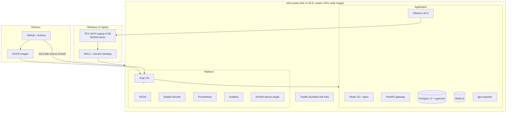

# Forge: Tech Stack

Every version below is pinned exactly (no `latest`). Rule from the spec: each dependency was released at least two weeks before 2026-10-25. Versions come from `gateway/pyproject.toml`, `web/package.json`, the Dockerfiles, Helm values and `gitops/apps/`.

---

## Runtime and platform

| Component | Version | Why chosen |
|---|---|---|
| Docker Desktop (WSL2 backend) | installed on host | Provides the GPU to Linux containers on Windows |
| k3d / k3s | k3s `v1.35.9-k3s1` | Real Kubernetes in a container; light enough to leave room for VRAM and RAM |
| Node image | `forge/k3s-gpu:v1.35.9-k3s1` on `ubuntu:noble-20260917` | Stock k3s image has no glibc, so the NVIDIA toolkit cannot run there |
| NVIDIA Container Toolkit | `1.20.1-1` | Hands `/dev/dxg` and driver libraries to containers |
| NVIDIA device plugin | `nvcr.io/nvidia/k8s-device-plugin:v0.20.1` | Advertises `nvidia.com/gpu: 1` to Kubernetes |
| Traefik | bundled with k3s | Ingress controller, no extra install |
| Argo CD | Helm chart `10.10.2` (Argo CD v3.5.4) | GitOps: cluster follows Git, app-of-apps, sync waves |
| KEDA | chart `2.21.0` | Scale to zero with a `metrics-api` trigger; plain HPA cannot scale to 0 |
| Sealed Secrets | chart `helm-v2.20.0` (git tag) | Commit encrypted secrets safely; fits GitOps |
| kubeseal CLI | `0.40.0` (checksum-verified download) | Encrypts secrets for the controller |
| Prometheus | Helm chart `prometheus` `29.36.1` | Metrics storage and scraping; lighter than the full operator stack |
| Grafana | Helm chart `grafana` `13.5.0` | Dashboards; sidecar loads the "Forge" dashboard from a ConfigMap |
| Helm | v4 | Packaging for both Forge charts |
| Kubernetes minimum | `>=1.33` (forge), `>=1.31` (forge-inference) | `preStop` sleep action; KEDA support range |

## Inference

| Component | Version | Why chosen |
|---|---|---|
| Ollama | `0.40.2` | Inference engine (llama.cpp underneath) with an OpenAI-compatible API; runs the GGUF Q4_K_M models, keeps all three loaded, KV cache quantized to q8_0. Same version verified on this GPU in gpu-hello. Why not vLLM or llama-server: LEARNING-GUIDE 4.7a |
| Chat model | `qwen2.5-coder:7b` (Q4, 5.02 GB) | Best coding quality that fits 8 GB next to the other two models |
| Autocomplete model | `qwen2.5-coder:1.5b-base` (1.30 GB) | Base model required for FIM; fast (about 120 tok/s) |
| Embedding model | `nomic-embed-text:v1.5` (0.32 GB, 768 dims) | Small, good quality, long context, needs task prefixes |
| Redis | `8.6.6-alpine` | Atomic Lua scripts, pub/sub, TTL keys: ideal for the shared queue and counters |

## Gateway (Python)

Base image: `python:3.12.14-slim-trixie` (pinned by digest in `gateway/Dockerfile`). Python `>=3.12,<3.13`.

| Package | Version | Why chosen |
|---|---|---|
| FastAPI | 0.143.0 | Async, typed, easy SSE streaming |
| uvicorn | 0.54.0 | ASGI server |
| SQLAlchemy (asyncio) | 2.1.4 | ORM with async support |
| greenlet | 3.5.6 | Required by SQLAlchemy async |
| asyncpg | 0.32.0 | Fast async Postgres driver |
| Alembic | 1.20.0 | Schema migrations (one initial migration, run by a Job) |
| pgvector (Python) | 0.5.1 | Vector type and `cosine_distance` for SQLAlchemy |
| redis-py | 8.1.0 | Async client, Lua scripts, pub/sub |
| httpx | 0.28.1 | Async streaming HTTP client to Ollama |
| prometheus-client | 0.26.0 | `/metrics` |
| pydantic / pydantic-settings | 2.14.1 / 2.15.0 | Request validation and `FORGE_*` env settings |
| itsdangerous | 2.2.0 | Signed admin session cookie |
| Dev only: pytest 9.1.1, pytest-asyncio 1.4.0, fakeredis 2.39.0, lupa 2.8, ruff 0.17.0 | | Tests (fakeredis + lupa runs the Lua scripts), lint |
| uv | lockfile `gateway/uv.lock`, `exclude-newer = 2026-10-12` | Reproducible installs; enforces the two-week rule for transitive packages |

## Database

| Component | Version | Why chosen |
|---|---|---|
| Postgres + pgvector | image `pgvector/pgvector:0.8.7-pg17-bookworm` | One database for relational data and vector search; no extra vector DB to run |

## Web console

Build image `node:24.21.0-alpine3.24`, run image `nginxinc/nginx-unprivileged:1.31.5-alpine3.24` (both pinned by digest). Node `>=22.12`.

| Package | Version | Why chosen |
|---|---|---|
| React / react-dom | 18.3.1 | Stable, widely known |
| react-router-dom | 7.18.4 | Client-side routing |
| react-markdown + remark-gfm | 10.1.0 / 4.0.1 | Render model answers safely |
| highlight.js | 11.11.1 | Code highlighting |
| uPlot | 1.6.32 | Tiny, fast charts for usage |
| TypeScript | 6.0.3 | Type-checked build (`tsc --noEmit`) |
| Vite | 8.3.4 with @vitejs/plugin-react 6.1.2 | Fast build |
| Vitest | 5.0.3 | Unit tests (SSE parser, API client) |

## GPU exporter

`python:3.12.14-slim-bookworm`, Python standard library only. Needs glibc because on WSL2 the NVIDIA runtime injects the host's `nvidia-smi` into the container.

## CI/CD

| Component | Detail | Why chosen |
|---|---|---|
| GitHub Actions | `ci.yaml`, `promote.yaml` | Same platform as the repo and GHCR |
| Third-party actions | checkout v7.0.1, setup-uv v10.3.0, setup-node v7.1.0, setup-helm v5.0.1, docker/setup-buildx v4.4.1, login v4.6.0, metadata v6.2.0, build-push v7.4.0 | Pinned by full commit SHA (supply-chain safety) |
| GHCR | `ghcr.io/gagan046-dev/forge-{gateway,web,gpu-exporter}:sha-<7 hex>` | Free, public images, no pull secrets |
| kubeconform | checksum-verified in CI | Validates rendered manifests against Kubernetes schemas |
| Ubuntu runner | `ubuntu-24.04` | Pinned runner image |

## Security

| Measure | Detail |
|---|---|
| Containers | non-root, read-only root filesystem where practical, all capabilities dropped, seccomp `RuntimeDefault` |
| Namespaces | Pod Security "restricted" labels |
| Network | default-deny NetworkPolicies; Ollama and Redis reachable only from gateways |
| API keys | SHA-256 hashed, shown once |
| Admin | HttpOnly SameSite=Lax signed cookie, CSRF header, login rate limit |
| Secrets in Git | Sealed Secrets only; plain text in git-ignored `secrets\` |
| Ingress | `/internal` and `/metrics` not exposed |
